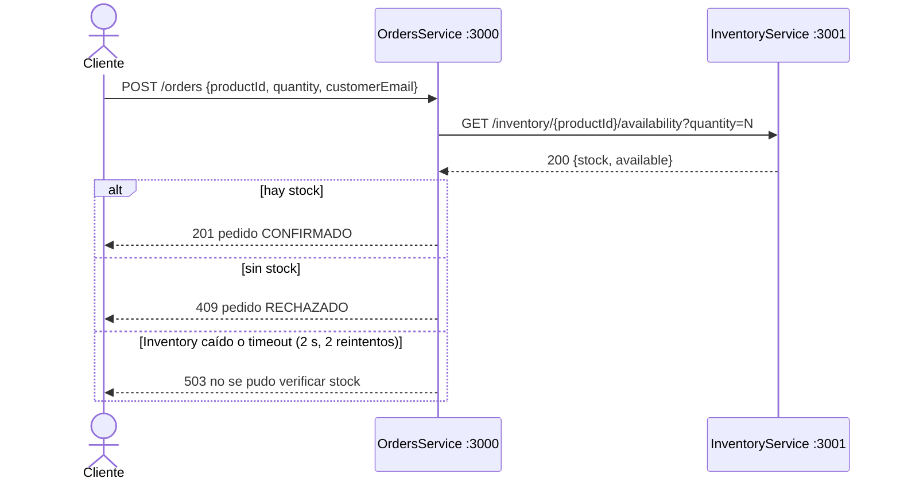

# Ejercicio 1: Comunicación síncrona con REST

`OrdersService` le consulta a `InventoryService` si hay stock **antes** de confirmar el pedido.
La llamada es **síncrona**: el cliente que crea el pedido espera mientras Orders espera a Inventory.



Para la comparación pedida, `InventoryService` también expone el mismo método por **gRPC** (puerto 50051,
contrato en [`proto/inventory.proto`](proto/inventory.proto)) y `OrdersService` puede usar cualquiera de los dos
cambiando una variable de entorno.

## Estructura

```
ejercicio1-rest/
├── docker-compose.yml
├── proto/inventory.proto          # contrato gRPC
├── inventory-service/
│   ├── Data.cs                    # stock en memoria (P001=10, P002=0, P003=3)
│   ├── Program.cs                 # API REST
│   └── GrpcService.cs             # misma operación por gRPC
└── orders-service/
    ├── Program.cs                 # API de pedidos
    ├── InventoryClient.cs         # cliente REST y cliente gRPC + reintentos
    └── Benchmark.cs               # REST vs gRPC
```

## Cómo ejecutarlo

Requisito: Docker Desktop.

```bash
cd ejercicio1-rest
docker compose up --build
```

### Cómo probar cada servicio

### 1. Levantar la pila

Desde la carpeta del ejercicio:

```bash
cd ejercicio1-rest
docker compose up --build
```

Esto levanta:
- **inventory-service** → `http://localhost:3001` (REST) + gRPC en `localhost:50051`
- **orders-service** → `http://localhost:3000`

### 2. Endpoints disponibles

| Servicio | Puerto | Endpoint | Método | Descripción |
|----------|--------|----------|--------|-------------|
| InventoryService | 3001 | `/health` | GET | Estado del servicio |
| InventoryService | 3001 | `/inventory` | GET | Lista de productos con stock |
| InventoryService | 3001 | `/inventory/{productId}` | GET | Detalle de un producto |
| InventoryService | 3001 | `/inventory/{productId}/availability?quantity=N` | GET | Verificar stock disponible |
| InventoryService | 50051 | `inventory.proto` | gRPC | `CheckAvailability` (opcional, vía `INVENTORY_PROTOCOL=grpc`) |
| OrdersService | 3000 | `/health` | GET | Estado del servicio |
| OrdersService | 3000 | `/orders` | GET | Listar todos los pedidos |
| OrdersService | 3000 | `/orders/{id}` | GET | Detalle de un pedido |
| OrdersService | 3000 | `/orders` | POST | Crear un pedido (cuerpo: `productId`, `quantity`, `customerEmail`) |

### 3. Comandos de prueba (`curl`)

Los ejemplos usan `curl` con sintaxis de bash (en Windows: **Git Bash**). También podés usar
[`requests.http`](requests.http) con la extensión *REST Client* de VS Code, o PowerShell (ver el README principal).

```bash
# --- Health de ambos servicios ---
curl http://localhost:3001/health
curl http://localhost:3000/health

# --- Inventario ---
curl http://localhost:3001/inventory
curl http://localhost:3001/inventory/P001
curl "http://localhost:3001/inventory/P003/availability?quantity=5"

# --- Pedidos ---
# 1) Stock disponible -> 201 CONFIRMADO
curl -X POST http://localhost:3000/orders -H "Content-Type: application/json" \
  -d '{"productId":"P001","quantity":2,"customerEmail":"ana@example.com"}'

# 2) Sin stock -> 409 RECHAZADO
curl -X POST http://localhost:3000/orders -H "Content-Type: application/json" \
  -d '{"productId":"P002","quantity":1,"customerEmail":"ana@example.com"}'

# 3) Producto inexistente -> 404
curl -X POST http://localhost:3000/orders -H "Content-Type: application/json" \
  -d '{"productId":"P999","quantity":1,"customerEmail":"ana@example.com"}'

# Listar pedidos
curl http://localhost:3000/orders
```

### 4. Usar gRPC en lugar de REST (sólo Inventory ↔ Orders)

```bash
# Linux / Git Bash
INVENTORY_PROTOCOL=grpc docker compose up -d --build
```

La respuesta de `POST /orders` mostrará `"inventoryCheck": {"protocol": "grpc", ...}`.

### 5. Benchmark REST vs gRPC

```bash
docker compose exec orders-service dotnet OrdersService.dll benchmark
```


### Escenarios de falla (lo interesante de la comunicación síncrona)

```bash
# Inventory caído: Orders reintenta 2 veces y responde 503
docker compose stop inventory-service
curl -X POST http://localhost:3000/orders -H "Content-Type: application/json" -d '{"productId":"P001","quantity":1,"customerEmail":"ana@example.com"}'
docker compose start inventory-service

# Inventory lento (3 s) con timeout de 2 s en Orders -> 503 después de ~6.6 s (3 intentos)
# PowerShell:  $env:SIMULATED_LATENCY_MS=3000; docker compose up -d inventory-service
SIMULATED_LATENCY_MS=3000 docker compose up -d inventory-service
```

Qué se ve:
- **Inventory caído:** no se puede crear ningún pedido. La disponibilidad de Orders queda atada a la de Inventory
  (acoplamiento temporal).
- **Inventory lento:** el cliente espera *timeout × intentos*. Sin timeout, los hilos o conexiones de Orders quedarían
  colgados. Además, reintentar un timeout multiplica la carga sobre un servicio que ya está saturado. En producción
  esto se acota con *circuit breaker* y *backoff* con jitter.

### Usar gRPC en lugar de REST

```bash
# Linux / Git Bash
INVENTORY_PROTOCOL=grpc docker compose up -d --build
# PowerShell
$env:INVENTORY_PROTOCOL="grpc"; docker compose up -d --build
```

El endpoint `POST /orders` no cambia. La respuesta muestra `"inventoryCheck": {"protocol": "grpc", ...}`.

### Benchmark REST vs gRPC

```bash
docker compose exec orders-service dotnet OrdersService.dll benchmark
```

Mide latencia (p50/p95/p99) de llamadas secuenciales, throughput con 50 llamadas concurrentes y el tamaño del
payload de respuesta. Los números dependen de la máquina, así que conviene anotar los propios:

| Protocolo | p50 (ms) | p95 (ms) | req/s (conc=50) | Payload respuesta |
|-----------|---------:|---------:|----------------:|------------------:|
| REST/JSON |          |          |                 | 89 bytes          |
| gRPC/Protobuf |      |          |                 | 31 bytes          |

(Los tamaños de payload son exactos para `P001`: el JSON repite los nombres de los campos y Protobuf usa números de
campo y varints. A eso REST le suma los headers HTTP/1.1 en texto y gRPC los headers HTTP/2 comprimidos con HPACK.)

---

## Comparación: gRPC vs REST en este escenario

| Aspecto | REST (lo implementado) | gRPC |
|---|---|---|
| Transporte | HTTP/1.1 (una request por conexión a la vez, keep-alive) | HTTP/2: multiplexa muchas llamadas sobre una sola conexión |
| Formato | JSON en texto, legible, más pesado (89 B en este caso) | Protocol Buffers binario, compacto (31 B) y más rápido de serializar |
| Contrato | Implícito o documentado aparte (OpenAPI opcional). Si Inventory renombra `available`, Orders se rompe en runtime | `.proto` obligatorio y compartido. Se generan stubs tipados y los cambios incompatibles se detectan antes |
| Evolución | Versionado por URL o headers, a criterio | Reglas claras: agregar campos con números nuevos es compatible hacia atrás |
| Timeouts | Cada cliente pone el suyo (`AbortSignal.timeout`) | **Deadlines** nativos que se propagan entre servicios encadenados |
| Errores | Códigos HTTP (404, 409, 503) | Status gRPC (`NOT_FOUND`, `UNAVAILABLE`, `DEADLINE_EXCEEDED`) |
| Streaming | No nativo (habría que usar SSE o WebSocket) | Unario, server, client y bidireccional |
| Herramientas y depuración | `curl`, navegador, Postman. Se lee a simple vista | Hace falta `grpcurl` o Postman con el `.proto`. El tráfico es binario |
| Navegadores y clientes externos | Soporte universal | Necesita gRPC-Web + proxy (Envoy) |
| Caché e infraestructura | Caché HTTP, proxies y API gateways estándar | Requiere balanceo L7 consciente de HTTP/2. Con L4 todas las llamadas van a una sola instancia por la conexión persistente |

**Conclusión para este caso.** La consulta de stock es una llamada **interna entre servicios** que está en la
**ruta crítica** de cada pedido y se repite mucho. Ahí gRPC aporta un contrato fuerte entre los dos equipos, menor
latencia y payload, conexiones multiplexadas y deadlines propagados. REST conviene cuando la API se expone a
terceros o a un front web, cuando el volumen es bajo o cuando importa más la simplicidad de depuración. Para un
prototipo como este, REST alcanza y sobra.

Ojo: **ninguno de los dos resuelve el problema de fondo**. Ambos son síncronos, así que si Inventory se cae o se
pone lento, Orders también deja de poder confirmar pedidos (se ve en los escenarios de falla). gRPC hace la llamada
más eficiente, pero no la desacopla. Eso es lo que motiva la mensajería asíncrona de los ejercicios 2 y 3.

> Mejora para producción: además de consultar, Inventory debería **reservar** el stock en una operación atómica.
> Si se consulta y se confirma por separado, dos pedidos simultáneos pueden ver el mismo stock disponible
> (condición de carrera *check-then-act*).
