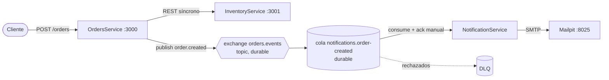

# Ejercicio 2: Comunicación asíncrona con RabbitMQ

Cuando se crea un pedido, `OrdersService` publica el mensaje **PedidoCreado** en RabbitMQ y responde al cliente
enseguida. `NotificationService` consume la cola y le envía un correo al cliente. Los correos se capturan con
**Mailpit**, un SMTP de pruebas con bandeja web, así que no sale ningún mail real.



| Servicio | URL |
|---|---|
| OrdersService | http://localhost:3000 |
| RabbitMQ Management | http://localhost:15672 (usuario `admin`, contraseña `admin`) |
| Mailpit, bandeja de entrada | http://localhost:8025 |

## Cómo ejecutarlo

```bash
cd ejercicio2-rabbitmq
docker compose up --build
```

Crear un pedido (Git Bash; también podés usar [`requests.http`](requests.http)):

```bash
curl -X POST http://localhost:3000/orders -H "Content-Type: application/json" \
  -d '{"productId":"P001","quantity":2,"customerEmail":"ana@example.com"}'
```

La respuesta llega al instante (`201`, `"eventPublished": true`) y el correo *"Recibimos tu pedido #…"* aparece en
http://localhost:8025.

## Decisiones de diseño

| Decisión | Para qué |
|---|---|
| Exchange `topic` + routing key `order.created` | Más adelante otros servicios pueden suscribirse a `order.*` sin tocar Orders |
| Cola y exchange **durables** + mensajes **persistentes** (`deliveryMode 2`) + volumen Docker | Los mensajes sobreviven a un reinicio del broker |
| **Publisher confirms** (`createConfirmChannel`) | Orders sabe que RabbitMQ realmente guardó el mensaje |
| Orders **también declara la cola** | Si Notification nunca arrancó, el mensaje no se descarta por falta de cola enlazada |
| **ACK manual** (`noAck: false`), recién después de enviar el mail | Si Notification se cae a mitad de proceso, el mensaje vuelve a la cola |
| `prefetch(5)` | Limita los mensajes en vuelo por consumidor (control de flujo) |
| Reintento único + **Dead Letter Queue** | Un mensaje que falla siempre no bloquea la cola: queda en la DLQ para analizarlo |
| Deduplicación por `eventId` | La entrega es *at-least-once*, así que un mensaje puede llegar dos veces |
| Outbox en memoria en Orders | Si RabbitMQ está caído, el pedido se acepta igual y el evento se reenvía al reconectar |

## Pregunta: ¿qué ocurre si NotificationService está caído temporalmente?

**Respuesta corta:** no se pierde nada y los pedidos se siguen creando. Los mensajes **se acumulan en la cola** de
RabbitMQ. Cuando NotificationService vuelve, los consume en orden y envía todos los correos atrasados.

Detalle:

1. **OrdersService no se entera ni se ve afectado.** Publica en el *exchange*, no en el consumidor. Mientras RabbitMQ
   esté arriba, `POST /orders` sigue respondiendo `201` igual de rápido. Este es el desacoplamiento temporal que en el
   ejercicio 1 no teníamos: allí, con Inventory caído, no se podía crear ningún pedido.
2. **Los mensajes esperan en la cola.** Como la cola es durable, los mensajes son persistentes y Orders declaró la
   cola, RabbitMQ los guarda (en disco) aunque no haya consumidores conectados. Incluso sobreviven a un reinicio del
   propio broker.
3. **Al volver, procesa el backlog.** NotificationService se reconecta, recibe los mensajes pendientes (de a 5 por
   el `prefetch`) y envía los correos. El log muestra cuánto tiempo esperó cada uno:
   `Recibido PedidoCreado ... (publicado hace 42.3 s)`.
4. **Si se cae a mitad de un mensaje,** ese mensaje no tenía `ack`, así que RabbitMQ lo vuelve a entregar
   (`redelivered = true`). Por eso es *at-least-once* y el consumidor tiene que ser **idempotente**: en el peor caso
   el cliente recibiría el mail dos veces. Acá se mitiga deduplicando por `eventId`.
5. **La consecuencia es la latencia, no la pérdida.** El cliente recibe el correo tarde (consistencia eventual).
   Si la caída se prolonga, la cola crece. Conviene monitorear su largo, ponerle TTL o un límite (`x-max-length`) y
   escalar consumidores.

Esto se cumple **sólo** gracias a la configuración. Con una cola no durable, mensajes no persistentes,
`noAck: true` o una cola que declara únicamente el consumidor, los mensajes se pueden perder.

### Cómo demostrarlo

```bash
# 1. Bajar NotificationService
docker compose stop notification-service

# 2. Crear algunos pedidos: Orders responde 201 normalmente
curl -X POST http://localhost:3000/orders -H "Content-Type: application/json" \
  -d '{"productId":"P001","quantity":1,"customerEmail":"ana@example.com"}'
curl -X POST http://localhost:3000/orders -H "Content-Type: application/json" \
  -d '{"productId":"P003","quantity":1,"customerEmail":"juan@example.com"}'

# 3. Ver los mensajes acumulados: UI http://localhost:15672 -> Queues -> notifications.order-created ("Ready": 2)
docker compose exec rabbitmq rabbitmqctl list_queues name messages_ready messages_unacknowledged
#    Mailpit (http://localhost:8025) todavía no tiene correos nuevos.

# 4. Levantarlo de nuevo y mirar cómo procesa el backlog
docker compose start notification-service
docker compose logs -f notification-service
```

Variante: con `PROCESSING_DELAY_MS=3000 docker compose up -d notification-service` cada envío tarda 3 s, y en la UI
se ve la columna *Unacked* (mensajes en proceso, todavía sin `ack`). Si en ese momento se hace
`docker compose kill notification-service`, esos mensajes vuelven a *Ready*.

¿Y si el que se cae es **RabbitMQ**? Orders acepta el pedido igual (`"eventPublished": false`, y
`GET /health` muestra `pendingEvents`) y lo publica cuando vuelve la conexión. En producción ese "pendiente" se guarda
en la base de datos, en la misma transacción que el pedido (**patrón Transactional Outbox**). Así no se pierde si
Orders también se reinicia.
