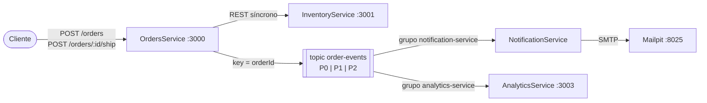

# Ejercicio 3: Procesamiento de eventos con Kafka

Cada cambio de estado del pedido se publica como evento en el topic **`order-events`**. Ese topic lo consumen,
**cada uno a su ritmo y de forma independiente**, `NotificationService` (manda un correo por cada cambio) y el
nuevo `AnalyticsService` (calcula métricas).



### Estados y eventos

```
POST /orders ──► CREADO ──(hay stock)──► CONFIRMADO ──POST /orders/:id/ship──► ENVIADO
                   │                         OrderConfirmed                       OrderShipped
                   │ OrderCreated
                   └──(sin stock)──► RECHAZADO  (OrderRejected)
```

Ejemplo de evento:

```json
{
  "eventId": "8d4c…", "eventType": "OrderConfirmed", "orderId": "66d2d468-…",
  "status": "CONFIRMADO", "previousStatus": "CREADO", "occurredAt": "2026-10-14T18:54:14.162Z",
  "data": { "customerEmail": "ana@example.com", "productId": "P001", "productName": "Teclado mecánico", "quantity": 2 }
}
```

| Servicio | URL |
|---|---|
| OrdersService | http://localhost:3000 |
| InventoryService | http://localhost:3001 |
| AnalyticsService | http://localhost:3003 |
| Kafka UI (topics, particiones, mensajes, consumer groups) | http://localhost:8080 |
| Mailpit, bandeja de entrada | http://localhost:8025 |
| Kafka para clientes externos | `localhost:9092` |

## Cómo ejecutarlo

```bash
cd ejercicio3-kafka
docker compose up --build
```

Esto levanta:
- **inventory-service** → `http://localhost:3001`
- **orders-service** → `http://localhost:3000`
- **analytics-service** → `http://localhost:3003`
- **kafka** → `localhost:9092` (broker) + `http://localhost:8080` (UI)
- **mailpit** → `http://localhost:8025` (correos de prueba)
- **notification-service** → consume Kafka y envía correos (no expone HTTP)
- **kafka-init** → crea el topic `order-events` con 3 particiones y termina (normal que salga con `exit code 0`)

Kafka tarda unos 20–30 s en estar listo.

## Cómo probar cada servicio

### Endpoints disponibles

| Servicio | Puerto | Endpoint | Método | Descripción |
|----------|--------|----------|--------|-------------|
| InventoryService | 3001 | `/health` | GET | Estado del servicio |
| InventoryService | 3001 | `/inventory` | GET | Lista de productos con stock |
| InventoryService | 3001 | `/inventory/{productId}` | GET | Detalle de un producto |
| InventoryService | 3001 | `/inventory/{productId}/availability?quantity=N` | GET | Verificar stock disponible |
| OrdersService | 3000 | `/health` | GET | Estado del servicio (incluye `kafka` y `pendingEvents`) |
| OrdersService | 3000 | `/orders` | GET | Listar todos los pedidos |
| OrdersService | 3000 | `/orders/{id}` | GET | Detalle de un pedido |
| OrdersService | 3000 | `/orders` | POST | Crear un pedido (cuerpo: `productId`, `quantity`, `customerEmail`) |
| OrdersService | 3000 | `/orders/{id}/ship` | POST | Marcar pedido como enviado (genera `OrderShipped`) |
| OrdersService | 3000 | `/orders/{id}/confirm` | POST | Confirmar un pedido pendiente (genera `OrderConfirmed`) |
| AnalyticsService | 3003 | `/stats` | GET | Métricas globales de pedidos |
| AnalyticsService | 3003 | `/stats/orders/{id}` | GET | Línea de tiempo de un pedido (partición y offsets) |

### Comandos de prueba (`curl`)

```bash
# --- Health ---
curl http://localhost:3001/health          # inventory
curl http://localhost:3000/health          # orders (muestra kafka: conectado)

# --- Inventario ---
curl http://localhost:3001/inventory
curl http://localhost:3001/inventory/P001
curl "http://localhost:3001/inventory/P003/availability?quantity=5"

# 1. Crear un pedido: genera OrderCreated + OrderConfirmed
curl -X POST http://localhost:3000/orders -H "Content-Type: application/json" \
  -d '{"productId":"P001","quantity":2,"customerEmail":"ana@example.com"}'
#    -> copiar el "id" de la respuesta (ej. <id>)

# 2. Despacharlo: genera OrderShipped
curl -X POST http://localhost:3000/orders/<id>/ship

# 3. Pedido sin stock: genera OrderCreated + OrderRejected
curl -X POST http://localhost:3000/orders -H "Content-Type: application/json" \
  -d '{"productId":"P002","quantity":1,"customerEmail":"juan@example.com"}'

# Si Inventory está caído, el pedido queda CREADO (202). Confirmarlo después:
# curl -X POST http://localhost:3000/orders/<id>/confirm

# 4. Ver resultados
curl http://localhost:3003/stats              # métricas de Analytics
curl http://localhost:3003/stats/orders/<id>  # línea de tiempo del pedido (partición y offsets)
#    Correos: http://localhost:8025 (3 para ana, 2 para juan)
#    Eventos en Kafka UI: http://localhost:8080 -> topic order-events
```

Si InventoryService está caído al crear el pedido, este queda **CREADO** (respuesta `202`) y se confirma después con
`POST /orders/<id>/confirm`.

## Decisiones de diseño

- **Un solo topic con todos los estados**, con `key = orderId`. Kafka garantiza orden **sólo dentro de una
  partición**. Como la partición se elige por hash de la key, todos los eventos de un mismo pedido caen en la misma
  partición y se consumen en orden (CREADO → CONFIRMADO → ENVIADO). Pedidos distintos se reparten entre las 3
  particiones y se pueden procesar en paralelo.
- **Un consumer group por servicio.** Cada grupo tiene sus propios offsets, así que los dos servicios reciben
  *todos* los eventos sin interferir entre sí. Para escalar, se agregan instancias del **mismo** grupo
  (`docker compose up -d --scale notification-service=3`) y Kafka les reparte las particiones (máximo 3 consumidores
  activos por grupo, uno por partición).
- **Productor idempotente + `acks=all`.** Los reintentos del productor no generan duplicados y un evento confirmado
  no se pierde.
- **Notification confirma offsets** después de enviar el mail (*at-least-once*). Si se cae, al volver sigue desde
  el último offset confirmado y deduplica por `eventId`.
- **Analytics no confirma offsets** (`autoCommit: false`). Cada vez que arranca **relee el topic entero** y
  reconstruye sus métricas en memoria. Esto es *replay*, y sólo funciona porque Kafka conserva los eventos
  (retención de 7 días configurada).

### Demostraciones útiles

```bash
# Replay: reiniciar Analytics -> recalcula exactamente las mismas métricas desde el log
docker compose restart analytics-service
curl http://localhost:3003/stats

# Consumidor caído: bajar Notification, crear y despachar pedidos, y levantarlo.
# Retoma desde su offset y manda los mails atrasados. Analytics no se enteró de nada.
docker compose stop notification-service
# ... crear pedidos ...
docker compose start notification-service && docker compose logs -f notification-service

# Lag de cada consumer group (cuántos eventos le faltan leer)
docker compose exec kafka /opt/kafka/bin/kafka-consumer-groups.sh --bootstrap-server localhost:9092 --describe --group notification-service

# Leer el topic "a mano" desde el principio
docker compose exec kafka /opt/kafka/bin/kafka-console-consumer.sh --bootstrap-server localhost:9092 \
  --topic order-events --from-beginning --property print.key=true --property print.partition=true
```

---

## Pregunta: ¿qué diferencias notarías entre usar Kafka y RabbitMQ en este escenario?

| | **RabbitMQ** (ejercicio 2) | **Kafka** (ejercicio 3) |
|---|---|---|
| Modelo | **Cola de mensajes** (*smart broker*): el broker enruta (exchanges, routing keys) y lleva la cuenta de qué se entregó | **Log distribuido** de solo-agregado (*dumb broker, smart consumer*): el consumidor lleva su propia posición (offset) |
| Qué pasa al consumir | El mensaje **se borra** de la cola al recibir el `ack` | El evento **queda en el log** hasta que vence la retención. Leerlo no lo borra |
| Agregar un consumidor nuevo (AnalyticsService) | Hay que crear **otra cola** y enlazarla al exchange. Sólo recibe los mensajes **a partir de ese momento** | Se crea un **consumer group nuevo** y no se toca nada más. Puede leer **todo el historial** desde el offset 0 |
| Reprocesar o *replay* | No se puede: lo consumido ya no existe (salvo que se haya guardado aparte) | Natural: se resetea el offset o se relee (Analytics lo hace en cada arranque) |
| Orden | FIFO por cola. Con varios consumidores en paralelo y reintentos (requeue), el orden se puede alterar | Garantizado **por partición**. Con `key = orderId`, CREADO → CONFIRMADO → ENVIADO llegan en orden |
| Escalado de consumidores | *Competing consumers*: se suman instancias a la cola sin límite | Paralelismo limitado por el **número de particiones** (acá, 3 instancias como máximo por grupo) |
| Throughput y latencia | Muy baja latencia por mensaje. Throughput de miles a decenas de miles de mensajes por segundo | Pensado para **volumen muy alto** (cientos de miles por segundo o más) con escritura secuencial y batching. Latencia algo mayor |
| Enrutamiento | Rico: direct, topic, fanout, headers. Prioridades, TTL, DLQ y *delayed messages* listos para usar | Básico: topic + partición. DLQ, reintentos con demora y filtrado se arman del lado del consumidor |
| Fallas en un mensaje | `nack` + requeue o DLQ por mensaje | No hay ack por mensaje: si no se avanza el offset, la partición queda **bloqueada** en ese evento. Hace falta un topic de reintentos o DLQ propio |
| Operación | Liviano, fácil de levantar y administrar (UI incluida) | Más pesado (JVM, particiones, réplicas, retención). Más conceptos que entender |

**En este caso concreto:**

- Con la consigna del ejercicio 3 (*cada cambio de estado, consumido por varios servicios*), **Kafka encaja mejor**.
  Son **eventos de dominio** (hechos que ya ocurrieron) y no comandos. Varios consumidores independientes los leen
  y aparecen consumidores nuevos con el tiempo. A Analytics le sirve el **historial completo** y el **replay**, y el
  **orden por pedido** importa (no tiene sentido notificar "enviado" antes que "confirmado"). Además, Kafka funciona
  como registro auditable de todo lo que le pasó a cada pedido.
- Para la tarea puntual del ejercicio 2 (*mandar un mail por pedido creado*), **RabbitMQ es más simple y alcanza**.
  Es un trabajo que se hace una vez y se descarta, con reintentos y DLQ por mensaje ya incluidos, y no hace falta
  historial. Kafka ahí sería sobredimensionado.
- Con RabbitMQ también se puede hacer *pub/sub* (un exchange `topic` con una cola por servicio). Pero cada servicio
  nuevo empieza "desde ahora", no hay replay y el orden se pierde con reintentos o consumidores en paralelo.
- Con Kafka, en cambio, si el envío de un mail falla una y otra vez, frena todos los eventos posteriores de esa
  partición. En RabbitMQ ese mensaje iría a la DLQ y el resto seguiría.

**Resumen:** RabbitMQ sirve para **distribuir tareas** a trabajadores (*"hacé esto"*). Kafka sirve para **publicar
un flujo de hechos** que muchos leen, releen y procesan cada uno a su ritmo (*"esto pasó"*). En un sistema real es
común usar ambos.
